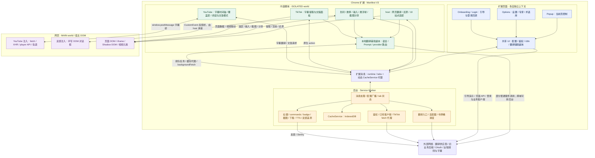
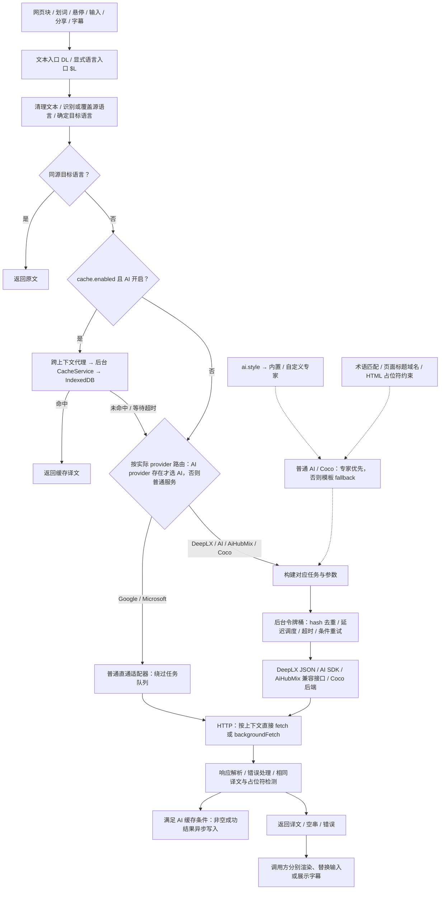
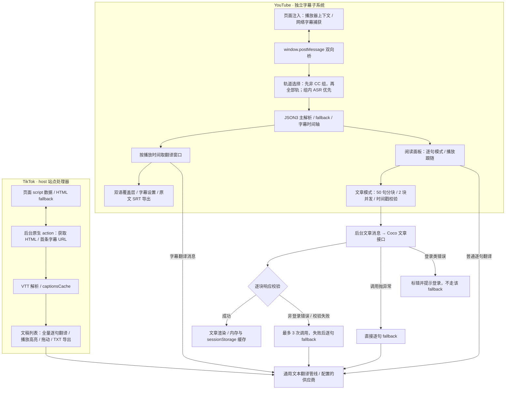
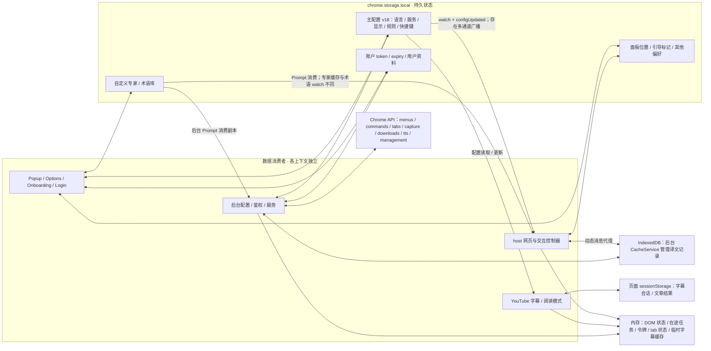

# 插件整体架构图 · 旧版恢复视图

[返回总索引](README.md) · [架构证据](modules/00-architecture.md) · [后续重构路线](implementation-roadmap.md)

对象是旧安装包 **1.0.109 / Manifest V3**。以下按真实执行环境、调用链和数据所有权绘制，是逻辑架构，不是恢复出的原始源码目录，也不是新骨架已经实现的能力。实线表示调用/数据交互，虚线表示功能依赖；双向箭头概括请求响应或读写，不表示两端有完全对称的API。

## 1. 整体运行架构：四类执行环境

蓝色是扩展页面，绿色是内容脚本，黄色是后台，紫色是宿主网页。网络节点只表示客户端可观察的接口边界，不展开服务器内部实现。

[独立 Mermaid 源文件](diagrams/01-runtime-boundaries.mmd)

读图要点：

- **后台不是唯一业务运行点。** 配置、鉴权、翻译及国际化辅助代码在多个bundle中有副本，页面会走本地辅助逻辑，跨域或特定任务再调用后台。图中的多个副本不是共享的同一个内存实例。
- **host 与 YouTube 字幕脚本分开。** host负责通用网页、交互、截图分享、站点适配和TikTok；YouTube有独立的内容脚本与页面注入桥。
- **网页世界与扩展内容世界分开。** YouTube通过postMessage交换播放器/字幕数据；反馈注入使用CustomEvent，host承接实际扩展请求。这些桥不等同于可信身份校验。
- **iframe不是无状态转发器。** 每个符合注入条件的子frame有自己的页面管理器，启停状态沿父子帧同步；划词和截图消息处理只在host顶层分支注册。跨frame状态不是单个全局React state。

依据：[00 执行环境与消息](modules/00-architecture.md)、[02 页面/iframe](modules/02-page-translation.md)、[09 后台与反馈](modules/09-browser-platform-and-feedback.md)。

## 2. 文本翻译核心：共享能力、不同入口与路由

这张图是跨上下文的逻辑调用图，不意味着图中所有函数都在Service Worker执行。字幕有通用文本入口，也有独立文章接口，后者见下一图。

[独立 Mermaid 源文件](diagrams/02-translation-pipeline.mmd)

| 分支 | 实际边界 |
| --- | --- |
| `DL` / `$L` | 普通文本自动识别，与显式语言覆盖入口的优先级不同；字幕不能简单等同网页语言配置 |
| 普通 Google / Microsoft | 正常入口绕过队列；Google内部按条件在最多三个端点间回退 |
| DeepLX / AI / AiHubMix / Coco | 构建任务交给后台令牌桶；容量不是严格在飞并发上限 |
| Prompt | 普通AI/Coco使用专家优先、模板fallback、术语与上下文；AiHubMix另有简单prompt，DeepLX不走该专家prompt |
| 译文缓存 | 当前文本入口只有满足`cache.enabled && AI开启`才读写；任务hash去重与译文持久缓存是不同机制 |
| 返回与错误 | 空字符串、原文、译文、抛错含义不同；队列重试、SDK重试、页面Coco累计重试不能合并为一个统一重试器 |

缓存命中路径与网络返回路径有不同控制流；图不保证旧缓存键已经包含全部Prompt/术语/上下文语义。超时也不等于底层网络已取消。来源：[01 翻译管线](modules/01-translation-providers.md)、[08 专家术语](modules/08-experts-and-termbase.md)。

## 3. 视频与阅读：YouTube、TikTok两条独立链路

[独立 Mermaid 源文件](diagrams/03-video-and-reading.mmd)

- YouTube轨道按组优先，不能概括为全局“始终ASR优先”；JSON3主解析与fallback各有行为。
- 阅读逐句缓存用修剪后的文本；文章逐句键包含起止时间和文本，外层文章sessionStorage键还包含标题/作者/语言/Prompt散列。
- 文章最多三次调用仅适用于进入重试的分支；异常提前fallback，登录类错误提示登录，不进入该fallback。普通逐句模式与文章精翻不是同一个服务。
- TikTok只用首条字幕信息及首URL，做列表文稿和TXT导出；没有因此恢复出YouTube同款的视频字幕覆盖层。
- 现有字幕来自平台已有字幕，不表示已恢复语音识别、视频转写或OCR。

来源：[05 YouTube](modules/05-video-subtitles.md)、[05a 阅读/文章](modules/05a-subtitle-reading.md)、[05b TikTok](modules/05b-tiktok-captions.md)、[07 客户端文章接口](modules/07-account-and-backend.md)。

## 4. 状态与平台：什么持久化，什么会丢失

图中连线表示逻辑消费者。IndexedDB代理调用实际由后台实例执行；不同配置仓库、不同存储以及不同上下文内存不能合并为一个“全局缓存”。

[独立 Mermaid 源文件](diagrams/04-state-and-platform.mmd)

| 状态类别 | 所有权与生命周期 |
| --- | --- |
| 配置/专家/术语/鉴权/偏好 | storage.local持久化，但各上下文还有自己的缓存；主配置watch、术语watch和专家Prompt副本的失效行为不同 |
| 译文记录 | 后台CacheService管理IndexedDB；无证据表明有额外内存译文front cache |
| 页面状态 | DOM标记、控制器及观察器随页面/frame；后台tab状态和popup显示通过消息协作 |
| 视频与文章状态 | 页面注入捕获缓存、字幕sessionStorage、文章缓存、TikTok的Cft内存captionsCache各自独立 |
| 调度与后台状态 | worker内的令牌、等待/执行map等不能视为跨Service Worker重启保存；图未暗示有持久任务队列 |
| 浏览器平台 | 后台承接截图、下载、TTS、菜单、快捷键、badge等；API调用成功不自动证明下载完成或语音实际停止 |

这里的`captionsCache`指host侧Cft的Map；后台TikTok代理与该内存缓存不是同一个对象。来源：[01 缓存/调度](modules/01-translation-providers.md)、[06 配置](modules/06-settings-and-configuration.md)、[08 独立仓库](modules/08-experts-and-termbase.md)、[09 平台](modules/09-browser-platform-and-feedback.md)。

## 5. 完整功能模块与架构归属

| 模块文档 | 架构责任 | 主要依赖与边界 |
| --- | --- | --- |
| [00 架构](modules/00-architecture.md) | 执行环境、入口、消息及文件责任 | manifest、四类消息、上下文生命周期 |
| [01 翻译核心](modules/01-translation-providers.md) | 语言、适配器、Prompt、调度、缓存 | Google/MS直通；AI/DeepLX等排队；部分网络转后台 |
| [02 网页翻译](modules/02-page-translation.md) | DOM过滤分组、占位符、渲染/还原、懒加载、10站点 | host、iframe、Shadow DOM、观察器与SPA例外 |
| [03 交互](modules/03-selection-and-floating-ui.md) | 划词、悬停、输入、浮球、键盘与朗读 | host本地触发、翻译副本、后台TTS；竞态与清理边界 |
| [04 截图与分享](modules/04-screenshot-and-reading.md) | 选区、滚动拼接、Markdown编辑、PNG/ZIP | host DOM/canvas、后台capture/download；PDF仅外链，未恢复OCR |
| [05 YouTube字幕](modules/05-video-subtitles.md) | 页面捕获、轨道、解析、时间轴、覆盖层、SRT | 页面注入桥、后台字幕翻译、播放器与SPA |
| [05a 阅读与文章](modules/05a-subtitle-reading.md) | 播放器搬动、逐句模式、分块文章与缓存 | YouTube会话、普通翻译/独立Coco文章接口；无已确认专用朗读入口 |
| [05b TikTok](modules/05b-tiktok-captions.md) | 数据发现、首轨VTT、文稿列表、播放跟随、TXT | host站点handler、原生后台fetch代理、通用文本翻译 |
| [06 设置与引导](modules/06-settings-and-configuration.md) | popup/options/onboarding、schema18、迁移、自动保存 | storage.local、消息广播、语言和供应商设置 |
| [07 账户客户端](modules/07-account-and-backend.md) | 微信/Google OAuth、回调、token/refresh、订阅展示 | login页面、共享鉴权副本、旧业务API；服务器实现未恢复 |
| [08 专家与术语](modules/08-experts-and-termbase.md) | 风格、自定义专家、站点术语、JSON/CSV | 独立仓库、`ai.style`、Prompt构建；消费不等同所有UI开关 |
| [09 平台与观测](modules/09-browser-platform-and-feedback.md) | worker启动、tab状态、菜单、commands、截图/下载/TTS、反馈/Sentry | Chrome API、反馈DOM桥与业务提交；冲突扩展management行为单列 |
| [10 国际化与资源](modules/10-i18n-and-assets.md) | manifest/UI两套文案、插值回退、资源/构建边界 | 多份词典；分享编辑器本地资源缺失；注入脚本与静态资源 |

账户、配置与国际化辅助代码有页面/后台副本，图中的“后台鉴权”不意味着token只能由后台读取。反馈包含表单提交与错误提示一键上报两条入口，复用配置收集；不能把旧载荷视为已脱敏。

## 6. 外部系统及后续重构边界

翻译供应商、旧业务API（登录/用户/订阅/Coco/文章/反馈）、OAuth授权平台、视频站字幕端点、远程站点规则和Sentry均是外部边界。本项目恢复的是客户端契约，没有恢复服务端计费、配额事务、模型路由或OAuth内部校验，也没有验证其当前可用性。

这些图描述旧插件实际恢复结果。未来重构可沿用功能分层，但统一配置写入口、区分速率与并发、完善取消及缓存语义、收窄页面桥接协议等属于后续设计变更，不能画成旧包已经具备。具体分批依赖见[路线图](implementation-roadmap.md)。新工程目前仍为骨架，本次只新增文档和图源。
