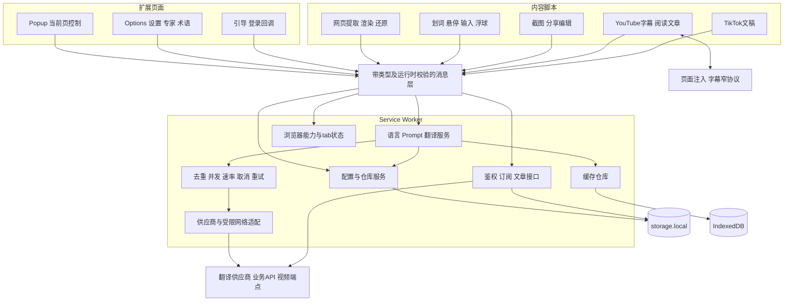

# 00 整体技术架构

[方案入口](README.md) · [协议与数据](13-protocols-and-data.md) · [实施与验收](14-implementation-and-validation.md)

## 1. 目标与范围

将网页内容翻译组织为可独立实现、可取消、可还原、可测试的模块。技术栈沿用工程现有WXT、React、TypeScript和Manifest V3。方案状态为待实施，当前工程的可运行能力是设置存储、弹窗、设置页、后台和页面通信。

功能范围包括网页翻译、站点适配、划词/悬停/输入、悬浮球、截图分享、YouTube字幕及阅读文章模式、TikTok文稿、配置引导、专家术语、账户客户端、平台能力和国际化。正式实施以每一批的验收条目确定交付范围。

截图功能使用浏览器截图和canvas拼接。PDF入口跳转在线工具。视频能力消费已有字幕。OCR、语音转写、支付服务及服务端模型路由另需产品和接口设计。

## 2. 恢复出的兼容基线

旧版本为1.0.109，主配置版本18。兼容基线的四类执行环境如下。

| 环境 | 恢复出的责任 | 生命周期 |
| --- | --- | --- |
| 扩展页面 | popup/options/onboarding/login，配置、鉴权、翻译辅助及词典副本 | 页面打开至关闭，各自有内存 |
| 内容脚本 | host处理DOM、交互、站点和TikTok，YouTube使用独立字幕脚本 | 每个frame和页面会话 |
| 页面世界 | YouTube播放器/字幕网络捕获，旧版反馈DOM注入与桥接 | 页面导航及注入会话 |
| Service Worker | 队列、译文数据库、平台API、消息、tab状态、业务API等 | 浏览器可停止并重建 |

旧版Google/Microsoft普通入口绕过任务队列，配置和翻译逻辑有多个副本。字幕postMessage、反馈CustomEvent、扩展消息库、TikTok原生action采用不同协议。该事实用于解释兼容差异，新方案按下一节收敛职责。

旧运行架构的完整可编辑图源保存在[兼容基线图](diagrams/baseline-runtime.mmd)。

## 3. 目标运行架构



**设计决策**。业务翻译、受限网络、队列和持久缓存集中后台。内容脚本持有DOM、用户交互和视频时间轴，提交结构化请求。扩展页面经配置服务读写偏好。共享代码以源模块复用，构建产生副本时仍按各上下文独立内存处理。

## 4. 模块边界

| 模块 | 输入与输出 | 责任界限 |
| --- | --- | --- |
| 翻译核心 | TranslationCommand → 后台解析请求 → TranslationResult | 语言、Prompt、服务选择、缓存与调度，见01 |
| 网页翻译 | DOM → 文本单元 → 可还原译文 | 过滤、分组、占位符、视口与动态扫描，见02 |
| 交互 | Selection/输入/快捷键 → 请求与呈现 | 选择范围、输入保护、UI会话，见03 |
| 截图分享 | 选区或译文块 → PNG/ZIP/下载任务 | 滚动恢复、画布预算、编辑器资源，见04 |
| 视频与阅读 | 平台字幕 → cue/文章块/显示 | YouTube、阅读文章、TikTok分别实现，见05–07 |
| 配置与仓库 | 校验过的补丁 → 新revision与通知 | 主配置、专家、术语、用户偏好，见08/10 |
| 账户服务 | 授权回调/有效会话 → 业务请求 | 刷新、订阅、短码及文章接口契约，见09 |
| 平台能力 | 窄操作请求 → 结果/状态事件 | 菜单、commands、截图、下载、TTS、反馈，见11 |
| 国际化资源 | UI语言/key/参数 → 文案与本地资源 | manifest与UI词典、注入文件，见12 |

## 5. 生命周期与一致性

tab/frame/document是浏览器容器身份，由sender与页面生命周期确定。同一容器内的页面翻译、划词、悬停、输入、截图、分享和视频各自拥有功能sessionId及generation。跨文档导航使该frame全部旧会话失效，新控制器创建新sessionId；同文档SPA重扫或配置更新递增对应功能generation。切视频建立新视频会话。成功、失败及进度回包都核对sessionId、generation和requestId。停止页面翻译仅撤销它拥有的会话，独立分享和其他模块按各自生命周期处理。

停止操作先使当前generation失效，再停止扫描和观察器、撤销任务订阅、清理UI并还原DOM。后台可中止仍有执行权的底层请求，共享任务按订阅者计数处理。任何异步错误处理都遵守同一世代判断。

Service Worker每次启动幂等注册消息和平台监听，恢复持久配置及数据库连接。队列、在途Promise、tab内存表和令牌随worker重启失效。客户端收到断连后显示可重试状态，重新读取实际页面状态，避免将内存表当作持久事实。

## 6. 存储分层

| 存储 | 数据 | 访问方式 |
| --- | --- | --- |
| storage.local | 配置、专家、术语、面板偏好、必要鉴权数据 | 后台仓库校验并串行写入 |
| IndexedDB | 译文记录、语义键、过期与使用时间 | 后台缓存仓库 |
| 页面sessionStorage | 可丢弃的字幕会话、文章结果 | 页面范围内按版本和语义键读取 |
| 内存 | DOM引用、观察器、任务订阅、队列、平台播放器上下文 | 绑定owner与清理函数 |

新扩展ID不能自动读取旧扩展的storage。迁移通过用户提供的导出数据进行。新schema先识别原版本并迁移，再做目标校验，原始导入文件在转换成功前保留。

## 7. 权限与信任边界

现有骨架权限为storage和activeTab。每批实现根据真实浏览器API新增所需权限。后台只暴露翻译、字幕抓取、截图、下载、朗读等具体操作，校验sender/tab/frame、输入大小、允许的协议和业务端点。

页面世界桥只承载字幕或播放器数据，使用固定namespace、会话标识、消息类型和输入结构。网页可观察或伪造页面内消息，因此敏感配置、token与任意fetch能力不得依赖页面桥授权。反馈在扩展控制的界面中构建显式脱敏载荷。

## 8. 建议目录

```text
src/
  entrypoints/           WXT入口与依赖装配
  core/                 contracts、语言、模型、校验
  background/           translation、queue、providers、repositories、platform
  content/              page、interactions、sites、video
  features/             settings、experts、termbase、account、share
  shared/               i18n、消息客户端、纯函数
public/                 图标与需要页面加载的本地资源
```

目录随实施批次建立。领域模块通过公共契约协作，避免业务代码依赖压缩符号、bundle文件名或另一个模块的私有控制器。

## 9. 架构验收

验证worker重启、无内容脚本、跨frame、重复初始化、配置并发更新、共享任务一方取消、页面导航后迟到失败、视频切换和DOM恢复。断连、取消和业务错误可分别定位。详细批次门槛见[实施与验收](14-implementation-and-validation.md)。
