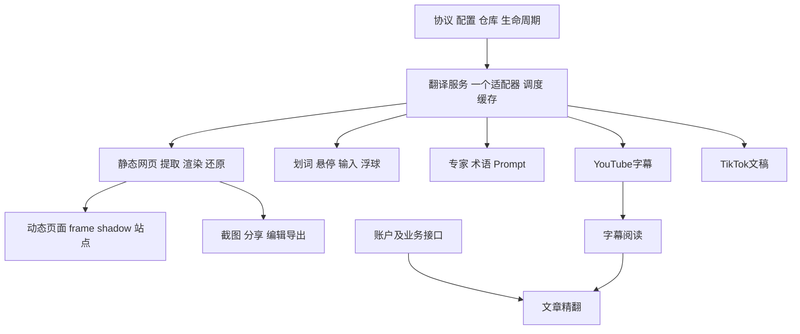

# 14 实施计划与验收设计

[方案入口](README.md) · [整体架构](00-architecture.md) · [协议与数据](13-protocols-and-data.md)

## 1. 交付原则

当前工程是可构建的MV3骨架。方案按功能闭环实施，每批包括实际入口、状态、失败处理、销毁和验收。功能开关只展示已经交付的能力，模型、旧后端、远程规则和站点选择器的可用性在对应批次单独核定。

本轮交付的是方案和资料整理，以下任务状态均为待实施。

## 2. 模块依赖

缓存、错误、取消、国际化和观测随功能批次交付。账户服务仅成为依赖该业务接口的功能前置条件。

## 3. 批次与完成门槛

| 批次 | 输入文档 | 交付闭环 | 验收门槛 |
| --- | --- | --- | --- |
| A 协议配置 | 00/08/12/13 | schema、仓库、窄消息、revision、语言及worker启动 | 无/坏/旧/未知版本配置，数组替换，并发补丁，重复启动 |
| B 基础翻译 | 01/13 | 一个provider、语言解析、错误、真实并发、速率、取消、缓存 | 成功/同文/空文、HTTP错误、超时abort、共享任务取消、TTL/LRU |
| C 静态网页 | 02 | 过滤、行内分组、占位符、三显示模式、还原 | 链接/代码/HTML保护，19样式，富文本、重复启停和源文变化 |
| D 动态站点 | 02 | IO/Mutation、SPA、frame、ShadowRoot、10站点adapter | 懒加载预算、路由变更、跨frame同步、各站独立DOM fixture |
| E 交互平台 | 03/11 | 划词、悬停、输入、浮球、菜单、快捷键及TTS，逐个交付 | 迟到成功/失败、关闭、热启用、IME、编辑保护、朗读取消 |
| F 专家术语 | 01/08/10 | CRUD、唯一选择、Prompt组合、JSON/CSV | 开关生效、跨行CSV、删除当前专家、Prompt/缓存失效 |
| G 截图分享 | 04/11/12 | 选区、拼接、下载，再做源文快照/编辑/PNG/ZIP | 截图尺寸、缩放、切tab、finally恢复、资源、空编辑与下载状态 |
| H YouTube | 05/11/13 | 桥、捕获、选轨、解析、窗口翻译、覆盖层、SRT | CC/ASR组合、参数缺失、JSON3/VTT、seek/广告/导航、hook恢复 |
| I 字幕阅读 | 06 | 普通逐句列表、跟随、播放器移动恢复、缓存 | 逐句调度上限、重复文本、源SRT、关闭和位置恢复 |
| J TikTok | 07 | 页面元数据、受限fetch、首轨VTT、列表翻译和TXT | 多视频归属、相邻cue、多URL、目标语言、导航取消及导出 |
| K 账户业务 | 09/11 | 登录回调、刷新、订阅展示、短码、显式反馈 | state/expiry、并发刷新、未知会员、可信域、脱敏与重放边界 |
| L 文章模式 | 06/09 | 50句分块、2块并发、最多3次调用、校验与回退 | 登录不回退、异常提前回退、条数/顺序/时间戳、版本缓存 |

## 4. 测试层次

### 纯函数与离线契约

语言归一化、文本过滤、占位符、站点规则、显示决策、稳定缓存键、退避预算、CSV、JSON3/VTT/SRT、时间轴、文章对齐采用确定性fixture。输出期望同时标明保留旧语义还是执行新设计，避免将复现旧缺陷的探针当作正确产品行为。

provider使用本地mock断言请求方法、URL、headers、body和解析。业务接口的鉴权、配额和计费幂等性在服务端契约确认后另做集成测试。

### DOM与扩展集成

在真实Chromium扩展上下文验证Content Script、ISOLATED/MAIN桥、tab/frame、storage、worker重启、commands、capture、downloads和TTS。浏览器没有该能力时显示明确降级。页面夹具至少包括深DOM、行内链接、代码/公式、可编辑区域、open shadow、同源/跨源iframe和虚拟列表。

### 实际站点

每个站点单独验证选择器、导航及宿主布局。YouTube覆盖普通视频、手动/自动轨、字幕缺失、广告、seek、SPA及播放器元数据变化。TikTok覆盖多视频对象、无轨、字幕挑战页、视频切换和滚动。站点接口变化作为兼容任务处理。

## 5. 取消与错误验收矩阵

| 事件 | 内容脚本/UI | 后台/共享服务 | 成功条件 |
| --- | --- | --- | --- |
| 新选区或新输入 | 递增generation，保留当前用户输入 | 撤销旧订阅 | 旧成功与旧失败都无法覆盖 |
| 页面停止 | 停观察与扫描，撤销自有修改 | 取消页面任务订阅 | DOM恢复，其他模块不被误取消 |
| 切视频/切Prompt | 新session或generation | 缓存按新身份隔离 | 无跨视频或跨版本串写 |
| 单个共享订阅取消 | 本调用进入cancelled | 保留仍有效订阅 | 其他调用仍成功 |
| 全部订阅失效 | 清理局部状态 | abort底层网络 | 任务Promise有终态 |
| 超时 | 显示超时和重试入口 | abort并记入统一预算 | 无后台悬挂和无界重试 |
| worker被停止 | 明确断连并读回 | 冷启动恢复持久状态 | 不伪造旧任务完成 |

## 6. 需要产品或服务端确认的决策

| 事项 | 方案中的默认处理 | 落地前确认 |
| --- | --- | --- |
| Google第三层和微软旧签名 | 不复用旧固定凭证，适配器保留能力边界 | 合法授权、当前接口、展示可用服务 |
| DeepLX/AiHubMix/custom端点 | 明确协议和规范化规则 | 用户端点及模型的真实响应 |
| 账户/付费/Coco文章 | 客户端只按明确契约接入 | API域、身份、OAuth、配额、幂等、模型权限 |
| 分享编辑器 | 资源须本地完整打包 | 版本、许可、导出效果及体积 |
| 远程站点规则 | 内置规则优先可用，版本化装载 | 更新来源、schema、签名及缓存策略 |
| 遥测 | 默认关闭 | 数据白名单、开启方式、服务配置 |
| 旧用户数据 | 明确导出导入，不跨ID自动读取 | 字段映射、敏感字段、失败恢复 |

这些项目是实施前置决策，不应通过假接口、旧秘密或默认最高权限来补齐。

## 7. 工程完成定义

每批至少满足类型检查、生产构建及manifest引用检查，相关功能通过上述有针对性的fixture和浏览器验收，文档记录新旧语义差异和仍有的真实环境限制。新增权限须与功能一同说明，敏感值不能进入构建配置、截图诊断、日志、反馈或版本库。

目前可执行的工程检查为`npm run check`。本设计中的完整测试体系随各批建立。
