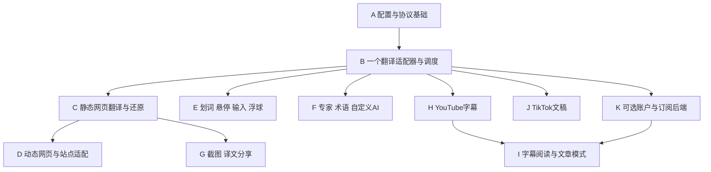

# 分批重构路线图

[返回总索引](README.md)。以下是基于旧包事实形成的**建议方案**，尚未实施。阶段编号用于后续分批安排，不表示用户已经批准实施全部附加功能。

## 1. 当前边界

新工程已有 WXT + React + TypeScript + MV3 骨架，生产构建、独立浏览器基础检查已完成。旧包仍在独立 evidence 目录中，不参与扩展打包。本次只整理文档/证据/分析工具，`src`、运行依赖、manifest权限没有因逆向工作扩展。

实现前先为要做的模块选择产品行为：保留旧语义、修复已确认缺陷，还是明确裁剪。修复不能悄悄伪装为“与旧版完全一致”；未实现功能不能在UI中显示为可用。

## 2. 依赖图

缓存、错误与观测随每批接入，不留到最后一次补齐。普通网页翻译不依赖账户、截图、视频或云端计费。

## 3. 建议批次与交付门槛

| 批次 | 阅读材料 | 交付范围 | 验收门槛 |
| --- | --- | --- | --- |
| A | 00、06、09 | 主配置仓库、版本迁移、窄消息协议、worker生命周期 | 首次/损坏/旧数据；并发更新；冷启动；内部页提示；保持最小所需权限 |
| B | 01 | 一个明确可用服务、统一TranslationRequest/Result、超时/取消、限流、缓存契约 | 用本地mock测成功/错误/429/timeout/abort；缓存键覆盖语义参数；不靠真实收费接口跑回归 |
| C | 02、06 | 静态文章DOM过滤/提取、占位符、安全渲染、双语/替换、还原 | 富文本/代码/链接不损坏；无重复译文；停止后完整还原；错误可重试 |
| D | 02 | IntersectionObserver/MutationObserver、iframe/ShadowRoot/SPA、站点规则 | 无限滚动；源内容变动；路由跳转；跨frame；站点逐个fixture验证 |
| E | 03、09 | 划词→悬停→输入→浮球→键盘/菜单/TTS，分别小批提交 | 选区改变、IME、contenteditable、快捷键冲突、拖拽、无voice、cleanup |
| F | 01、08 | 六风格与专家CRUD、术语库、JSON/CSV、自定义AI | 真实持久化；总开关生效；多行CSV；Prompt与缓存失效；供应商参数一致 |
| G | 04、09 | 框选截图/滚动拼接/下载，再做分享Markdown/图片/ZIP | DPR/滚动容器/边界恢复；资源全部本地可加载；导出可打开；取消和失败可恢复 |
| H | 05 | YouTube：纯解析→轨道选择→bridge捕获→时间轴→翻译→覆盖层 | JSON3/VTT/SRT fixture；seek/ad/SPA；原生CC；过期请求丢弃；重试Promise可settle |
| I | 05a、07 | 阅读逐句模式，再决定文章重写服务 | 播放器恢复原位置；chunk顺序/句数/时间戳不变；缓存版本；无账号时明确可用范围 |
| J | 05b | TikTok本地数据解析→字幕获取→列表翻译→导出 | 首/多轨选择；切视频取消；无空行VTT；TXT/SRT格式明确；观察器释放 |
| K | 07、09 | 可选新鉴权/订阅服务、反馈与遥测 | 客户端与服务器职责明确；callback/state/expiry/refresh；真实脱敏；不沿用旧秘密和服务身份 |

每批保持可运行、可审阅，不先把整个旧包翻译成TypeScript再一次性替换。先写局部契约和fixture；对DOM渲染、跨世界消息、浏览器API的改变需实际浏览器验收。

## 4. 已确认缺陷的处理清单

| 旧行为或缺口 | 建议决策 | 所属模块 |
| --- | --- | --- |
| maxConcurrent实际是令牌速率/容量 | 拆开并发上限与速率字段，迁移时明确映射 | 01 |
| AI temperature/customHeaders等字段未完全消费 | 只暴露适配器真实支持字段，契约测试核对网络payload | 01 |
| 缓存读不校验TTL，Prompt/上下文未完整入key | 定义语义键和读取过期策略；旧缓存可直接失效而非兼容所有旧键 | 01 |
| 默认DeepLX endpoint再拼/translate | 明确endpoint/baseURL语义，不把官方DeepL与DeepLX混为一个适配器 | 01 |
| popup按最后两个域名标签生成通配规则 | 优先精确hostname或明确站点范围；不要扩大到公共后缀 | 06 |
| 专家卡片setState和真实保存脱节 | 仓库写成功后再确认选择；与popup统一 | 08 |
| 术语总enabled未参与消费、CSV跨行不对称 | 全开关路径测试；明确标准CSV实现 | 08 |
| 字幕递归重试未连接父Promise | 有界、可取消、返回值能resolve/reject的重试 | 05 |
| TikTok无空行VTT/SPA清理边界 | 正式cue解析；每video generation token与cleanup | 05b |
| 分享所需vditor路径缺资源 | 选择新的本地编辑器或补齐明确资源；不保留失效静态声明 | 04 |
| 反馈载荷可能带嵌套key且页面桥接可见 | 新协议只发送显式脱敏诊断快照 | 09 |

这里只列已有具体代码证据的差异；不是要求本阶段开始修复。

## 5. 不可从安装包恢复的部分

服务端用户/订阅数据库、扣费事务、模型路由、OAuth平台内部校验、旧远程规则的历史内容、缺失资源的确切版本、原始源码命名与开发历史，都需要新的接口/产品决策或额外资料。后续实现时不得用臆造的“旧协议保证”填补这些空白。

功能完成标准以各模块末尾验收用例为准。文档交付的完整性与运行验证范围见 [证据与验证](evidence-and-validation.md)。
