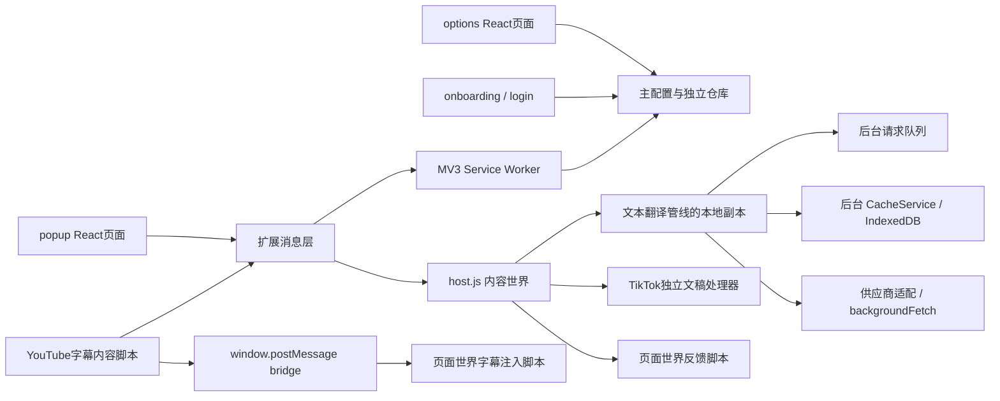

# 00 · 旧插件架构、执行入口与模块边界

[返回总索引](../README.md) · [证据方法与覆盖](../evidence-and-validation.md)

完整分层图见[插件整体架构图](../architecture-diagrams.md)，包含运行环境、翻译管线、视频阅读及状态存储四个视图。

## 1. 分析对象

- 安装包：`/Users/jiangding/yezi`，manifest version=`1.0.109`，Manifest V3。
- 固定副本：[evidence/legacy/original](../../evidence/legacy/original/)，53 个文件；文件级 SHA-256 见 [inventory.json](../../evidence/legacy/inventory.json)。
- 可读版本：[formatted](../../evidence/legacy/formatted/)，20 个 JS 文件用 TypeScript printer 重新排版，全部可以语法解析。**不是原始 TypeScript，也不是源码目录恢复**。
- 原包没有 source map，没有后端源码、开发依赖锁文件或原构建配置。因此恢复目标是可追溯的功能、控制流、数据契约和实现参考，不宣称恢复原作者全部源文件。

REA 识别的根 artifact SHA-256 为 `1341b092abe765b43cdd39c8062789a6c2b5cd1ecd51550a8fbac418389ba360`。这是 REA 对目录的身份定义；不要当成 CRX 签名、商店可信性或单个文件哈希。

## 2. 执行环境与依赖



这不是“所有请求都只在后台发出”的架构：host、api chunk、后台存在重复的配置和翻译辅助代码，普通服务有直接通路，跨域和特定服务会使用后台 fetch/队列。新工程不宜照搬每个 bundle 一份业务实现的形态。具体路由和例外见 [01](01-translation-providers.md)。

## 3. Manifest 入口和权限

| 声明 | 旧值 | 对分析的含义 |
| --- | --- | --- |
| background | `background.js` | Service Worker，负责配置、队列/缓存、平台API、账户支持服务 |
| action | `popup.html` | 工具栏弹窗为主点击入口 |
| options_ui | `options.html`，open_in_tab=true | 独立设置页 |
| host content script | `<all_urls>`、all_frames=true、host.css | 允许范围广，实际入口还有 scheme/站点过滤与重复加载保护 |
| exclude_matches | 百度/有道/Google/DeepL翻译站 | host 不自动注入这些匹配页面 |
| video content script | YouTube 两种域名匹配、all_frames=true | YouTube 独立字幕入口；TikTok由host进入 |
| web accessible | inject、feedback、icon、vditor资源、网站登录页 | 页面世界可加载这些本地资源；声明不保证文件实际存在 |
| 权限 | storage、activeTab、contextMenus、tabs、management、downloads、tts | 分别见 06/09；不是新工程当前权限要求 |
| host_permissions | `<all_urls>` | 旧后台可访问多供应商与业务服务 |
| commands | 切页面、截图 | 默认 Alt+X，Ctrl/Command+Shift+Z |

来源：[原始 manifest.json](../../evidence/legacy/original/manifest.json)。原 `key/update_url` 是旧身份/商店配置，本次没有迁移到新工程。

## 4. 代码文件按真实责任分组

| 文件 | 主要责任 | 关联模块 |
| --- | --- | --- |
| `background.js` | 配置/迁移、Sentry、服务API、调度、缓存、TikTok服务、菜单/快捷键、tab状态 | 01、05b、06、07、09 |
| `content-scripts/host.js` | 页面提取/还原、悬停/划词/输入、悬浮球、截图/分享、站点处理器、TikTok面板 | 02、03、04、05b |
| `content-scripts/video-subtitle.js` | YouTube字幕控制、解析、时间轴、渲染、阅读文章模式、quickButton | 05、05a |
| `video-subtitle-inject.js` | MAIN world 的fetch/XHR/player API桥接、字幕轨道与上下文缓存 | 05 |
| `feedback-modal.js` | DOM反馈窗口与CustomEvent桥接 | 09 |
| `chunks/api-CQ3fxAZ4.js` | 设置/引导等页面可调用的翻译API副本 | 01、06 |
| `chunks/wechat-auth-DcMIyx4V.js` | 共享React/组件依赖、主配置、鉴权、术语库等大量导出 | 06、07、08 |
| `chunks/DisplayModeSelector-aVEBmg_I.js` | 专家仓库、服务选择等共享组件/辅助函数 | 01、06、08 |
| `chunks/GoogleIcon-BH2pAel4.js` | 图标、UI翻译字典及共享业务UI | 06、07 |
| `chunks/reading-article-C1xHFmbV.js` | SDK/工具/站点规则等共享导出 | 01、02；不能从文件名推断通用网页阅读功能 |
| popup/options/login/onboarding chunks | 各页面入口 | 06、07、08 |
| preload-helper、index-*、x-*、file-text | 预加载/工具/组件/图标等依赖 | 随调用方保留，未把第三方库所有API算作插件功能 |
| CSS、locale、icons | 样式、文案、图片 | 02–09各UI；原字节全保留 |
| `_metadata/*` | 安装包校验元数据 | 保留，不代表本次验证了商店签名 |

**chunk 名称不是功能边界**。所有 53 文件的责任映射见 [artifact-coverage.json](../../evidence/legacy/artifact-coverage.json)。

## 5. 四类消息机制

| 通道 | 实际协议 | 用途/边界 |
| --- | --- | --- |
| 扩展消息库 | `sendMessage/onMessage`，含id/type/data/timestamp，底层API请求响应及部分错误序列化 | config、翻译、状态、后台fetch等；发tab时可带frameId |
| 原生runtime消息 | `{action:'tiktokFetchHtml' / 'tiktokFetchCaption',...}`；另有 `{type:'ping'}` | 不经过上述库的业务schema，不要混用包装方式 |
| 字幕window bridge | `{eventType:'congcong-subtitle-inject',to,from,type,data,id,isAsync}` | 页面世界与内容世界；默认超时resolve(null) |
| 反馈CustomEvent | `@webext-core/messaging/custom-events`，namespace=`coco-feedback-modal` | 页面脚本与host通信，字段可被页面观察/构造 |

核心34个业务名称见 [runtime-message-names.json](../../evidence/legacy/extracts/platform/runtime-message-names.json)。名称存在不等于每处都有监听器。完整 request/response 形状按各模块 handler 确认；`proxy-service.CacheService` 等动态通道不在这34项常量表中。

消息库的 `id` 用于日志，不参与按ID匹配响应；`handler` 同步抛错发生在 `Promise.resolve` 之前，不能一概视为封装成 `{err}`。各上下文仅允许同一type注册一个handler。扩展消息封装来源 [background LF3018–3080](../../evidence/legacy/formatted/background.js#L3018)，后台注册 [LF9060](../../evidence/legacy/formatted/background.js#L9060)，TikTok原生监听 [LF9721](../../evidence/legacy/formatted/background.js#L9721)，桥接见05/09。

## 6. 状态、生命周期与数据层

- 配置：storage.local + 每个执行上下文自己的内存缓存；主配置和术语有storage watch，专家管理UI与Prompt消费副本的缓存失效机制不同，详见06/08。schema version18，专家/术语另有独立仓库。
- 翻译缓存：后台 CacheService，通过代理服务暴露，译文保存在IndexedDB；该服务只缓存数据库连接/初始化状态及命中计数，未发现内存译文front cache，详见01。
- 页面翻译状态：host控制器/DOM标记、后台tab状态map与badge、popup订阅；不是一个共享React state。
- 视频：页面世界捕获缓存、内容脚本字幕session/时间轴、阅读文章缓存、TikTok的host侧Cft内存captionsCache彼此独立；后台TikTok fetch代理不是该缓存的所有者。
- 账户：本地token/expiry与刷新单飞机制；打开会员等Web入口时会换取短授权码，见07，不能推导所有Web业务都使用同一路径。
- 页面生命周期：host/视频都有自己的Observer、SPA检测、unload清理；一些旧路径存在竞态/未释放资源，详见各模块。

## 7. 新工程模块边界建议

以下只是设计方案，本阶段没有实现：

```text
src/core/config/        默认值、schema、版本迁移、唯一写入仓库
src/core/messages/      运行时可验证的协议与错误契约
src/core/translation/   语言、provider、prompt、term matching、结果规整
src/background/        网络适配、取消/限流、缓存、平台API
src/content/page/      DOM过滤/分组/占位符/renderer/restore
src/content/selection/ 划词、悬停、输入、快捷键、浮球
src/content/sites/     独立站点规则和adapter
src/content/video/     YouTube、TikTok、阅读模式分开
src/features/share/    截图拼接、Markdown、导出
src/features/account/  仅在明确采用新后端时接入
```

优先保持“提取→翻译→渲染→还原”分离；队列/缓存所有权集中后台；页面世界只能传字幕等窄数据。供应商、站点和UI不得互相穿透访问私有状态。依赖与交付顺序见 [分批路线图](../implementation-roadmap.md)。

## 8. 恢复范围的上限

已恢复的是安装包内业务算法、前端协议、UI状态转换和默认配置。没有恢复服务端鉴权/计费/模型路由源码，没有证明旧服务当前可用，没有拿到历史远程规则内容。缺失的 `vditor/dist/**` 资源不能凭 manifest 声明补造；旧网站选择器也需逐站点重新验证。
