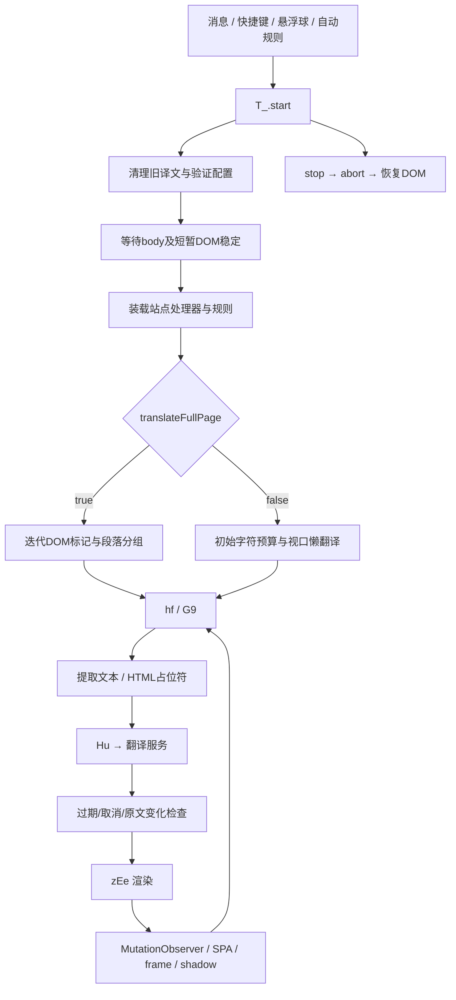

# 02 · 网页翻译管线、显示与站点适配

[返回技术方案入口](../README.md)

## 1. 证据范围与恢复程度

此模块基于 `1.0.109` 安装包的 `content-scripts/host.js` 静态调用关系恢复。原文件、可读排版、SHA-256 清单分别保存在 `evidence/legacy/original`、`formatted`、`inventory.json`。所有压缩符号均保留；本文使用的“扫描器”“任务”等中文名是语义说明，不是恢复出的原 TypeScript 名称。

**已确认：** 本地静态实现、调用关系、默认值与异常分支。**未确认：** 网站当前 DOM 是否仍匹配、真实翻译结果/网络可用性、线上远程站点规则的实际返回值。没有把字符串命中视为已运行验证。

## 2. 入口、生命周期与进程边界

- 旧 manifest 将 `host.js` 注入所有 frame，排除 Google/百度/有道/DeepL 的翻译页面。
- 顶层页面初始化 `rdt` 划词、`nRe` 悬停、`sdt` 输入翻译、`T_` 页面翻译、`Nlt` 悬浮球，并设置配置监听和消息监听。
- 子 frame 仅创建页面翻译管理器，通过 `__COCO_TRANSLATION_FRAME_SYNC__` 的 `request/state` 消息与父 frame 同步启停；同源 iframe 还可能由父管理器直接扫描。
- 外部入口：`toggleTranslate`、`revalidateTranslation`、`getTranslationState`、`canTranslate`。快捷键与悬浮球复用同一 `toggle()`。
- `T_.isTranslating` 实际返回 `isActive`，表示“翻译模式开启”，不能等同于“当前有网络请求”；`translationStatus` 才区分 `idle/translating/completed`；懒加载的启动/SPA重扫可以在异步扫描和后续翻译完成前就设为 `completed`，因此也不能把它当作所有内容已译完的保证。

主入口证据：[host L105970 起](../../evidence/legacy/formatted/content-scripts/host.js#L105970)，管理器见 [`T_`：host.js L105124–L105150](../../evidence/legacy/formatted/content-scripts/host.js#L105124)。



### 自动启动条件

`HY → bAe` 读取 `autoTranslatePatterns/neverTranslatePatterns` 和 `languagePatterns.alwaysTranslate/neverTranslate`，以 URL 通配规则和 `TY(document)` 检测结果决定启动；禁止语言或禁止网站阻止普通自动规则。另有 `hAe(url)` 特例。只有 `canTranslate` 成功且尚未开启才调用 `start({persistState:false})`。用户显式启停状态还通过页面 sessionStorage 保存，SPA 跳转会再次判断。

`TY` 优先读取HTML或meta语言；回退到文本时使用 `Nd`。后者若汉字占有效字符比例达到10%，先走中文判定，因此含汉字的日文可能被识别为中文，影响语言规则及其他复用 `Nd` 的路径；这不是对所有日文页面的断言（[host L3349–L3357](../../evidence/legacy/formatted/content-scripts/host.js#L3349)、[L9404–L9414](../../evidence/legacy/formatted/content-scripts/host.js#L9404)）。

证据：[`HY`：host.js L9514–L9516](../../evidence/legacy/formatted/content-scripts/host.js#L9514)、[`bAe`：host.js L9517–L9524](../../evidence/legacy/formatted/content-scripts/host.js#L9517)；持久状态及 Google Docs 特例见 [host L104542–L104572](../../evidence/legacy/formatted/content-scripts/host.js#L104542)。Google Docs `/edit` 可被重定向至 `/mobilebasic`，是旧包针对可扫描 HTML 的兼容措施，并非 Docs 编辑器内部渲染能力。

## 3. 文本范围、识别与过滤

### 3.1 选择根节点

`Uw` 缓存每个 Document 的翻译根。`range=main` 依次尝试 `main[role=main]`、`main#main-content`、`main`、`[role=main]`、`article[role=main]`、`article`，失败回退 body；`stripe.com`、`tiktok.com` 强制 body。`s4` 在后续动态扫描中约束同一根的包含关系，并处理 ShadowRoot.host。

证据：[`Uw`：host.js L30027–L30036](../../evidence/legacy/formatted/content-scripts/host.js#L30027)、[`s4`：host.js L30037–L30052](../../evidence/legacy/formatted/content-scripts/host.js#L30037)。

### 3.2 不可翻译节点与非语言文本

`qY` 的排除选择器覆盖 script/code/style/noscript/svg/canvas/video/audio、表单/可编辑区域、`[translate=false/no]`、`.cc-notranslate`、`[data-nosnippet]`、图片/role=img、Monaco、MathJax/KaTeX/math。图片不会在普通段落管线中被 OCR。

`a2/MAe/Q9e` 另过滤不可见元素、排除祖先、数字/单字符、邮箱、电话、URL、IP、路径、版本号、长哈希、UUID、代码样式和 aria-describedby 所属输入说明。`E9` 判断是 **长度达到 minLength 或词数达到 minWordCount**，不是两个条件都要求；导航列表可将兄弟文案合并判断，避免单个菜单项过短全部跳过。

配置默认 `textRange={minLength:10,minWordCount:2,maxLength:5000}`；显式 include 站点规则可绕过常规长度限制。最大长度过滤是跳过长段落，不应误写为“必然自动切成5000字符”。

证据：[`qY`：host.js L9855–L9855](../../evidence/legacy/formatted/content-scripts/host.js#L9855)、[`a2`：host.js L9588–L9607](../../evidence/legacy/formatted/content-scripts/host.js#L9588)、[`MAe`：host.js L9561–L9575](../../evidence/legacy/formatted/content-scripts/host.js#L9561)、[`Q9e`：host.js L9318–L9318](../../evidence/legacy/formatted/content-scripts/host.js#L9318)、[`E9`：host.js L9139–L9139](../../evidence/legacy/formatted/content-scripts/host.js#L9139)，以及 [host L9930 起](../../evidence/legacy/formatted/content-scripts/host.js#L9930)。

## 4. DOM分组与双路径调度

### 全量路径

`Tct → av → tpe → tst/nst → rst → S0/ast → hf/G9`。`tpe` 使用显式栈做后序遍历，避免深DOM递归爆栈，给块/行内/段落写标记。`ast` 按相邻行内节点分组，使用 `hY` 判断是否连续；遇到 iframe、块节点则分开。按钮/需原位替换元素分到专门支路。`rst` 的 `est(10)` 限制本轮遍历任务并发；管理器另有 `maxConcurrentTranslations=30`，后台网络队列还有独立限制，三者不可混为一个参数。

### 懒加载路径

`translateFullPage=false` 是旧默认。`g_ → qY/KY` 产生候选段落，优先消耗 `initialTranslateChars=4999`；计数只计算有效字符并保留内部空白，候选必须完整放入剩余额度才立即提交，不截断半个段落。短文本原文模式不消耗预算。超预算、隐藏等候选转为节点观察，IntersectionObserver 使用约 `1000px` rootMargin，接近视口后重新过滤并入队。移除节点会注销观察。

`ipe/g4` 将工作放入串行 enqueue 链，在并发上限下等待 `activeTranslations`，并携带 `currentWalkId` 与 AbortSignal；旧轮次/已停止任务不会继续写页面。

证据：[`av`：host.js L103661–L103663](../../evidence/legacy/formatted/content-scripts/host.js#L103661)、[`tpe`：host.js L103664–L103705](../../evidence/legacy/formatted/content-scripts/host.js#L103664)、[`rst`：host.js L103725–L103725](../../evidence/legacy/formatted/content-scripts/host.js#L103725)、[`ast`：host.js L103753–L103792](../../evidence/legacy/formatted/content-scripts/host.js#L103753)、[`g_`：host.js L104111–L104145](../../evidence/legacy/formatted/content-scripts/host.js#L104111)、[`dpe`：host.js L104098–L104106](../../evidence/legacy/formatted/content-scripts/host.js#L104098)、[`fpe`：host.js L104108–L104109](../../evidence/legacy/formatted/content-scripts/host.js#L104108)、[`ipe`：host.js L103939–L103948](../../evidence/legacy/formatted/content-scripts/host.js#L103939)、[`g4`：host.js L103949–L103958](../../evidence/legacy/formatted/content-scripts/host.js#L103949)、[`ope`：host.js L103959–L103960](../../evidence/legacy/formatted/content-scripts/host.js#L103959)、[$st](../../evidence/legacy/extracts/page/104017-$st.js)。

## 5. 提取、请求、占位符与安全回填

`hf` 是普通段落主要入口：

1. 检查取消、include/skip、专门元素、正在处理集合 `V9` 和已有译文。
2. `R9/fY` 将DOM转换为文本与占位符Map；`forceWhole` 用 `uY/dY` 保留换行 `__CCPHn__`。
3. 检查配置、禁止语言、长度、混合显示策略；创建 loading wrapper。
4. `ZEe → FS(Hu(...),signal)` 获取译文。`Hu` 去零宽字符、归一换行、检测语言、选择普通/AI提供方，可能读取AI缓存，并带页面上下文。具体服务协议见服务模块。
5. 响应返回后再次读源节点 `KEe`，若源文已变化抛 `SourceTextChangedError`；取消、无译文、归一后与原文相同均不渲染。
6. `zEe` 恢复占位符并插入译文；finally释放 `V9`，避免失败后永久锁定。

占位符生成覆盖行内HTML、代码等不可直接翻译结构。`cH` 提示词明确要求保留 HTML 和 `__CCPH\d+__`，并注入选中的专家风格、域名适用术语表与可选标题/域名上下文；这只是给模型的约束，不保证输出遵守。

`e2 → q9e` 在独立 span 中解析译文，允许标签白名单并去掉 `on*` 属性，不允许标签降成文本；在 A 容器里还会拆掉嵌套 A。**旧清理器没有完整URL协议校验**，重构不能把它等同于经过验证的通用HTML消毒器。

证据：[`hf`：host.js L10360–L10452](../../evidence/legacy/formatted/content-scripts/host.js#L10360)、[`R9`：host.js L9157–L9157](../../evidence/legacy/formatted/content-scripts/host.js#L9157)、[`uY`：host.js L9158–L9158](../../evidence/legacy/formatted/content-scripts/host.js#L9158)、[`ZEe`：host.js L10347–L10359](../../evidence/legacy/formatted/content-scripts/host.js#L10347)、[`Hu`：host.js L9011–L9056](../../evidence/legacy/formatted/content-scripts/host.js#L9011)、[`cH`：host.js L1636–L1683](../../evidence/legacy/formatted/content-scripts/host.js#L1636)、[`e2`：host.js L9243–L9244](../../evidence/legacy/formatted/content-scripts/host.js#L9243)、[`q9e`：host.js L9245–L9258](../../evidence/legacy/formatted/content-scripts/host.js#L9245)。

## 6. 双语、替换、混合显示与恢复

`BS` 输出统一渲染决策：`showTranslation/hideOriginal/replaceOriginal/variant`。双语保留源，替换隐藏源，混合模式按 `characterThreshold` 和 `shortTextMode` 决定短文本保留原文或原位替换。站点 `replaceSelectors` 可以强制替换。


来源：[`BS`：host.js L9875–L9881](../../evidence/legacy/formatted/content-scripts/host.js#L9875)；[完整摘录](../../evidence/legacy/extracts/page/9875-BS.js)。

```js
function BS(e, t = {}) { const n = i2(e), r = t.forceReplace ?? !1, o = { showTranslation: !0, hideOriginal: !1, replaceOriginal: !1, variant: "bilingual" }; if (r)
        return o.hideOriginal = !0, o.replaceOriginal = !0, o.variant = "replace", o; const d = t.textLength; switch (n.mode) {
        case "replace": return o.hideOriginal = !0, o.replaceOriginal = !0, o.variant = "replace", o;
        case "bilingual": return o;
        case "mixed": return typeof d == "number" && d <= n.characterThreshold ? n.shortTextMode === "original" ? (o.showTranslation = !1, o.hideOriginal = !1, o.replaceOriginal = !1, o.variant = "short-original", o) : (o.hideOriginal = !0, o.replaceOriginal = !0, o.variant = "replace", o) : o;
        default: return o;
    } }
```


`zEe` 根据原节点类型、富文本、父容器和多节点分组选择 clone、wrapper、插入位置，并保存原display。行内/换行由 `aX/sX` 结合 `alwaysNewLine/byLength`、forceInline/forceBlock 与邻接DOM决定。`lEe` 应用下划线/边框/高亮/marker等样式；相近语言高亮是展示功能，不是另外一个翻译引擎。

`Fct` 停止时先设 inactive、abort、停止观察和SPA监听，等排队/活动任务settle，再 `fg` 恢复原display、解包隐藏文本、移除译文/clone、多分组wrapper，清理ShadowRoot和iframe、站点teardown、统计，最后广播idle。原位textContent替换分支保存 `data-congcong-original-text`，不得只删除译文节点当作“还原完成”。

证据：[`zEe`：host.js L10163–L10268](../../evidence/legacy/formatted/content-scripts/host.js#L10163)、[`fg`：host.js L10109–L10109](../../evidence/legacy/formatted/content-scripts/host.js#L10109)、[`Fct`：host.js L105111–L105123](../../evidence/legacy/formatted/content-scripts/host.js#L105111)、[`XEe`：host.js L10326–L10346](../../evidence/legacy/formatted/content-scripts/host.js#L10326)。

## 7. 动态页面、iframe、Shadow DOM、SPA

- body Observer 监听 childList/subtree/characterData；attributes仅开启站点规则声明的 `translateAttributes`，刷新该属性翻译。
- 新元素递归发现 iframe、open ShadowRoot，并按全量/懒路径处理；characterData变更向上找已标记段落重新翻译。
- 同源iframe可用contentDocument，跨源不能直接读取；旧manifest allFrames允许各frame独立管理并靠postMessage同步。旧frame同步仅检查payload类型/动作，未校验origin/source，属于迁移时需修正的边界。
- 一般站点的SPA监听会hook pushState/replaceState、监听相关事件、500ms URL轮询、捕获链接点击，变化后debounce→停止旧任务/清旧DOM→稳定等待→重新载入规则与翻译。`zst` 对 x.com、twitter.com、github.com 及子域跳过这组监听；不能因此推断所有站点专属监听也不存在（[host L104480–L104481](../../evidence/legacy/formatted/content-scripts/host.js#L104480)）。
- stop恢复history原函数、撤销listeners/interval/observers；多轮切换要防止叠加监听。

懒加载扫描 `g_` 启动内部异步遍历后立即返回；SPA重扫在返回后设 `completed`，且异常分支也设 `completed`（[host L104111–L104145](../../evidence/legacy/formatted/content-scripts/host.js#L104111)、[L104501–L104515](../../evidence/legacy/formatted/content-scripts/host.js#L104501)）。

证据：[`hpe`：host.js L104224–L104251](../../evidence/legacy/formatted/content-scripts/host.js#L104224)、[`Gw`：host.js L104159–L104180](../../evidence/legacy/formatted/content-scripts/host.js#L104159)、[`y_`：host.js L104181–L104221](../../evidence/legacy/formatted/content-scripts/host.js#L104181)、[`pm`：host.js L104282–L104285](../../evidence/legacy/formatted/content-scripts/host.js#L104282)、[`gpe`：host.js L104286–L104309](../../evidence/legacy/formatted/content-scripts/host.js#L104286)、[`Lst`：host.js L104310–L104339](../../evidence/legacy/formatted/content-scripts/host.js#L104310)、[`lv`：host.js L104483–L104500](../../evidence/legacy/formatted/content-scripts/host.js#L104483)、[`Vst`：host.js L104501–L104515](../../evidence/legacy/formatted/content-scripts/host.js#L104501)、[`Kst`：host.js L104518–L104518](../../evidence/legacy/formatted/content-scripts/host.js#L104518)、[`Yst`：host.js L104521–L104521](../../evidence/legacy/formatted/content-scripts/host.js#L104521)、[`Zst`：host.js L104524–L104525](../../evidence/legacy/formatted/content-scripts/host.js#L104524)；frame同步 [host L106015 起](../../evidence/legacy/formatted/content-scripts/host.js#L106015)。

## 8. 站点适配规则与专属处理器

完整选择器已经机器提取至 [site-rules.json](../../evidence/legacy/extracts/page/site-rules.json)，保留10个站点metadata、include/exclude/forceInline/forceBlock/forceWhole/replace规则与默认feature。不要从下面摘要手抄替代完整JSON。

| 站点 | 规则/额外逻辑 | 主要源码位置 |
| --- | --- | --- |
| Google | 排除符号/图标，`googleTranslatePaEnabled` feature控制PA请求路径 | host L7746、106446 |
| GitHub | 排除diff、仓库导航/sidebar和元数据，部分aside替换；`bhe`处理特定页面结构 | host L106400–106446 |
| Instagram | 排除用户名等，独立翻译profile header/图片alt并附加overlay，保存和恢复header HTML、父元素style | host L106450–106593 |
| LinkedIn | whole/replace组织简介，排除more/ellipsis/footer | site-rules.json |
| Reddit | 排除flair/author/time/actions、强制块边界 | host L106594附近，site-rules.json |
| Telegram | 排除左侧导航 | site-rules.json |
| TikTok | bio/评论/标题专用规则；另有字幕抓取与文稿panel，不属于普通段落扫描 | host L106596–107394，字幕模块另述 |
| X/Twitter | tweetText整体处理，链接行内，排除身份、元信息 | host L107454，site-rules.json |
| YouTube | title/comment/chips单独include/whole，排除播放器字幕与元数据；SPA标题变化兼容 | host L107394–107453 |
| WhatsApp | 排除侧栏/联系人区 | host L107394附近，site-rules.json |

`_st/npe/cpt` 按URL匹配、优先级载入处理器；`p_` 将静态规则映射为DOM标记，并为同一个元素保存多个handler id，teardown仅撤自己的标记。`hst` 对指定属性维护原值/译文，可在attribute变更后重译、停止时恢复。

远程规则 `UBe/HK` 通过后台fetch加载OSS JSON，5秒超时、校验object和已知站点id，成功时以站点为单位替换 `Jf` 的属性，失败回退内置规则。但这些handler在异步启动让出执行后、`HK` 完成前已捕获各站点旧规则对象；替换 `Jf[id]` 不会更新handler持有的引用，YouTube还预先复制了规则。因此不能声称远端站点选择器会被这些handler采用。feature则在等待 `HK` 后读取，Google的该开关只影响前两种请求路径失败后的PA回退。安装包内带签名参数的URL只保留作历史证据，本次没有请求，不能推断该链接现在有效。

证据：[启动与同步初始化：host L105969–L105970](../../evidence/legacy/formatted/content-scripts/host.js#L105969)、[handler捕获：L106418–L106446](../../evidence/legacy/formatted/content-scripts/host.js#L106418)、[YouTube复制：L107411–L107413](../../evidence/legacy/formatted/content-scripts/host.js#L107411)、[Google回退：L8784–L8799](../../evidence/legacy/formatted/content-scripts/host.js#L8784)、[`UBe`：host.js L7748–L7767](../../evidence/legacy/formatted/content-scripts/host.js#L7748)、[`HK`：host.js L7770–L7770](../../evidence/legacy/formatted/content-scripts/host.js#L7770)、[`cpt`：host.js L107446–L107453](../../evidence/legacy/formatted/content-scripts/host.js#L107446)、[`p_`：host.js L103922–L103928](../../evidence/legacy/formatted/content-scripts/host.js#L103922)、[`hst`：host.js L103841–L103901](../../evidence/legacy/formatted/content-scripts/host.js#L103841)、[`Dst`：host.js L104388–L104435](../../evidence/legacy/formatted/content-scripts/host.js#L104388)、[`_st`：host.js L104349–L104387](../../evidence/legacy/formatted/content-scripts/host.js#L104349)。

### 8.1 专属处理器的行为差异

- **GitHub**：`bhe`找`.Layout-sidebar[data-view-component=true]`中的About描述；解除这些描述及祖先的站点exclude标记，而同侧栏其他子节点加notranslate。childList变化时重新处理。因此不只是静态include选择器。其直接加到旁支的 `cc-notranslate` 未由该handler清理闭包登记移除，可能在停止后留存，直到页面或其他代码移除。
- **Instagram header**：`eD.setup`保存原header HTML，注册变化/导航和400ms debounce，异步结果回填前检查节点和源内容；清理时恢复HTML。`xhe`用Unicode正则识别`@账号/#标签`，仅将其间普通文本送Hu，再保留原token和两端空白拼接；`aft`保留A/BR/STRONG/EM/B/I/SPAN结构，`nN/sft`将账号/话题重新建为Instagram链接。
- **Instagram图片alt**：`whe`扫描`._aagv img[alt]`，去掉alt中最后一个`created`后的尾段，按source属性去重后翻译；失败回退裁剪后的源文，创建图片下方两行overlay。保存祖先inline position/marginBottom并设relative与42px留白，teardown恢复样式、移除overlay/标记。此功能翻译HTML alt，不是识别图像像素。
- **YouTube页面**：`lpt`最多4秒等页面container出现；`ept`尝试从forceBlock中过滤 `#content-text span:first-child`；但本包内置规则只在include中有此选择器，forceBlock本就没有，因此此过滤对当前fallback没有效果；`Qft`显式管理idle→initializing→active/paused→tearingDown→disposed。setup尝试点开description expander，load后150ms、导航后200ms开始，查找最多10次；监听manager URL变化、yt-navigate-finish和fullscreen变化，全屏时隐藏悬浮球，清理后恢复。字幕获取/渲染另见视频模块。
- LinkedIn/Reddit/Telegram/WhatsApp/X处理器主要是静态规则+setup/cleanup，当前未见对应handler内额外的网络/结构算法；不要为了架构对称虚构专属引擎。

精确代码：[`bhe`：host.js L106424–L106440](../../evidence/legacy/formatted/content-scripts/host.js#L106424)、[`eD`：host.js L106450–L106475](../../evidence/legacy/formatted/content-scripts/host.js#L106450)、[`xhe`：host.js L106477–L106495](../../evidence/legacy/formatted/content-scripts/host.js#L106477)、[`aft`：host.js L106496–L106524](../../evidence/legacy/formatted/content-scripts/host.js#L106496)、[`whe`：host.js L106546–L106578](../../evidence/legacy/formatted/content-scripts/host.js#L106546)、[`nN`：host.js L106579–L106582](../../evidence/legacy/formatted/content-scripts/host.js#L106579)、[`sft`：host.js L106583–L106590](../../evidence/legacy/formatted/content-scripts/host.js#L106583)、[`lpt`：host.js L107419–L107427](../../evidence/legacy/formatted/content-scripts/host.js#L107419)、[`Qft`：host.js L107395–L107410](../../evidence/legacy/formatted/content-scripts/host.js#L107395)、[`cD`：host.js L107428–L107445](../../evidence/legacy/formatted/content-scripts/host.js#L107428)。

## 9. 错误与诊断

管理器累计翻译失败，阈值1/5/10/25后提示，间隔/显示时长约5秒；区分Google服务错误、Coco额度/会员/登录错误，分别引导设置/登录/订阅/重试，并可上报错误。另有冲突扩展提示，调用后台management能力关闭冲突扩展。它们是旧包事实，不构成新工程自动保留这些权限的要求。

证据：[host L104697 起冲突通知](../../evidence/legacy/formatted/content-scripts/host.js#L104697)、[L104934 起错误通知](../../evidence/legacy/formatted/content-scripts/host.js#L104934)。

## 10. 分批重构方案（建议，尚未实现）

| 批次 | 模块边界与交付 | 前置依赖 |
| --- | --- | --- |
| P1 | `PageSession`启停/epoch/abort，`TextCollector`只读候选扫描，`TranslationBlock`保存source snapshot | 配置、消息、单个翻译服务 |
| P2 | 一对一双语节点渲染与完整restore，HTML占位符和严格URL/标签处理 | P1 |
| P3 | mixed/replace/样式策略，行内分组、whole、属性翻译 | P2 |
| P4 | 初始字符预算、IntersectionObserver、可取消队列与请求统计 | P2 |
| P5 | MutationObserver、SPA、Shadow DOM/frame隔离与可信消息协议 | P4 |
| P6 | 规则JSON与独立站点adapter，逐站点固定fixture验收，最后启用远程规则 | P5 |

建议用小的显式接口：`collect(root,options) → AsyncIterable<Block>`、`translate(block,signal)`、`render(block,result) → restore()`，而不是将6MB host搬进新源码。源码体积中包含React、组件库、Markdown编辑器和SDK等依赖，不能视为6MB全是业务逻辑。专家/术语表归服务层，页面只提供context与结构占位符。

## 11. 验收用例与未知

- 中英混排、导航短词、同源语种、只含数字/URL/代码、MathJax、editable表单应符合过滤规则。
- 富文本链接/强调/代码保留语义；译文插入后原页面点击行为与DOM结构可恢复。
- stop发生在请求中/返回瞬间/源文改变时都不写旧结果；开启关闭多轮无重复wrapper。
- 首批严格不超预算，大段落不截断；滚动进入近视口才排队；移除节点释放观察。
- SPA重复切换、动态characterData、iframe导航、open shadow新节点都不复用旧轮次。
- 全量/懒翻译分别验证idle/translating/completed语义，活动模式可completed后因新内容回translating。
- 当前静态证据不能证明全网站兼容；closed ShadowRoot、canvas和Chrome受限页面未恢复为可翻译能力。

本模块完整摘录与调用符号：[extracts/page/index.json](../../evidence/legacy/extracts/page/index.json)。入口列表/数据类型请结合其他模块；REA全包覆盖与限制以总索引中的分析记录为准。
