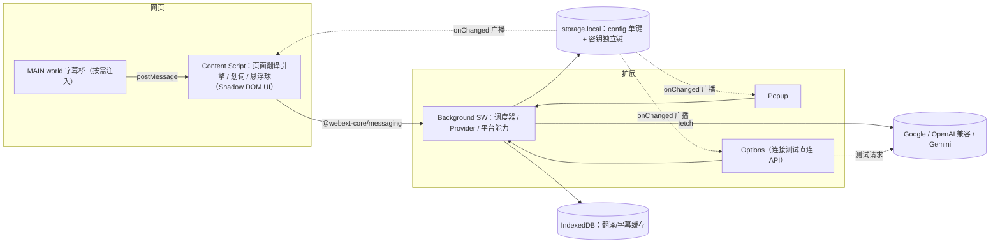

# Easy Translate 从零设计评审（2026-11-13）

> 评审范围：`docs/design/00–15` 全部设计文档、`reference/*.json`、`src/` 现有骨架代码。
> 范围约定（用户已确认）：账户、登录、订阅/会员、短码及 Coco 等依赖账户的服务端接口**暂不做**，架构上只留扩展点。**文章精翻为必做功能**，改为基于用户自配 AI 供应商（BYOK）实现。优先级：先完整交付全部翻译能力（网页、划词/悬停/输入、字幕翻译、字幕阅读、文章精翻、TikTok），账户相关放到最后视情况再定。

## 1. 总体评价

**优点（值得保留）**

1. **验收清单质量高**：竞态防护（generation/摘要校验、迟到结果丢弃）、页面还原、取消语义这些清单抓住了翻译扩展最容易烂的地方，应原样进入新方案的验收门槛。
2. **"后台统一调度翻译"的分层正确**：内容脚本只发命令、后台解析请求并调度，这是 MV3 下的正解，保留。
3. **兼容策略清醒**：明确不跨扩展 ID 读旧数据、不复用旧固定凭证（Google 第三层、微软签名），避免了最大的合规坑。
4. **站点规则做成数据（JSON 选择器）而非代码**，方向正确；内置 10 站约 9KB，体量可控。
5. **文档对自身风险有标注**（如"私有接口须实施时验证"），诚实度高，便于裁剪。

**主要问题**

1. **协议层过重**：所有消息套 RequestEnvelope（protocolVersion/requestId/sessionId/generation）四件套、9 个消息族、config 的 revision 乐观锁 + path 白名单 patch——对单用户本地扩展是分布式系统级的设计，成本远超收益。
2. **特性面铺得过宽且同级排期**：A–L 12 批把"稳定的核心能力"（翻译、页面、交互）和"逆向依赖的脆弱功能"（YouTube pot 令牌、TikTok CDN、Coco 后端）混排，后者随时失效却占用约 1/3 批次。
3. **历史包袱当设计约束**：v18 迁移表（约 15 条规则，但新扩展根本读不到旧数据）、50 条旧缺陷清单、8 个 fallback modelId、19 种显示样式，都是逆向笔记而非需求。
4. **缺工程地基**：无测试框架、无 lint、无 schema 校验库、无文本批量合并策略（一次请求多段，直接决定成本和速度）、无性能预算，而这些比 12 批功能更先决。
5. **默认依赖不可控外部**：Google 非官方端点做默认、PDF 跳转 cocotranslate.com、GitHub 规则依赖 CSS Modules 哈希类名，上线即面临失效风险。

## 2. 推荐的目标架构

**运行环境划分（3+1 层）**

- **Background（SW）**：翻译调度器（队列、并发、重试、去重）、Provider 适配、IndexedDB 缓存、配置仓库唯一写入点、平台能力（右键菜单、commands、TTS、下载）。所有监听器顶层幂等注册，不依赖内存状态存活；worker 重启后由内容脚本负责重发在途请求。
- **Content Script（ISOLATED，`<all_urls>`）**：页面翻译引擎（扫描/分组/渲染/还原）、划词/悬停、悬浮球。所有注入 UI 走 WXT `createShadowRootUi` 统一样式隔离。页面会话状态（generation、还原记录）**只在内容脚本本地维护**，不进消息协议。
- **MAIN world 桥**：仅字幕类功能需要，按站点懒注入；优先直取 `ytInitialPlayerResponse` 等内嵌数据，网络 hook 只作回退。桥是不可信边界，不承载任何授权。
- **扩展页面**：Popup（当前站开关 + 快捷入口）、Options（6 路由压成 3：通用/服务/专家术语）。Provider 连接测试由 Options 页面**直接 fetch**，不经消息传递明文 key。

**模块边界**（`src/lib/` 纯逻辑可单测，`src/entrypoints/` 只做装配）：`config`（zod schema + 仓库）、`providers`（函数式 Provider 接口：`translate(batch, ctx) => Result`）、`translator`（调度/缓存/批量合并）、`messaging`（类型化协议）、`page`（DOM 引擎）、`features/*`（subtitle、capture 等独立可拆包）。**账户扩展点**：预留 `AuthState` 接口（默认恒为匿名）、tier 判断函数（默认全放行）、Provider 注册表可追加 coco——仅此三处，不提前写设计。

**文章精翻（BYOK）设计**：入口在字幕阅读面板。流程：取全量 cue → 按 50 句/块切分、块并发 2（沿用文档参数）→ prompt = 本地文章化模板（迁入 `features/subtitle/article-prompt.ts`，可叠加当前专家风格）→ 经 translator 的通用 LLM provider 通道发出（复用并发/重试/取消/缓存，不新增调用路径）→ 返回 JSON 用 zod 校验（条数、顺序、时间戳规则沿用 06 文档）→ 校验失败的块整块降级为逐句翻译，不中断其他块。缓存键含 prompt 版本；UI 按块显示进度与部分成功。原设计的 Coco 固定模型、幂等门槛、登录错误分支全部删除；将来接入账户只需在 provider 注册表追加 coco，一行不改业务逻辑。

**消息与状态**：`@webext-core/messaging` 定义类型化 ProtocolMap，消息族收敛为 5 类（translation / config / page-command / subtitle / platform）。配置状态 = `storage.local` 单键整对象，`onChanged` 即广播，UI 侧一个 `useConfig()` hook 订阅，不引状态管理库。

**存储**：`storage.local` 存 ConfigV1（整体读→校验→整体写，最后写入为准）；密钥独立键、默认不随导出（MV3 下无可靠加密，文档中"敏感存储"实际也只能如此，直说明文风险即可）；IndexedDB（idb）存翻译缓存（LRU 按字节 + TTL）与字幕缓存。缓存键收敛为 6 字段哈希：provider + model + 源语 + 目标语 + prompt 版本 + 文本。

**权限**：`storage`、`activeTab`、`contextMenus`、`commands` + 内容脚本 `<all_urls>` + `host_permissions` 仅列 provider API 域名。截图用 activeTab 手势链路；`scripting`、`downloads`、`tts` 随对应批次再加。

## 3. 关键技术选型

| 领域 | 选择 | 理由 / 不选的替代 |
|---|---|---|
| 消息库 | **@webext-core/messaging** | 类型化 ProtocolMap、自动 requestId、与 WXT 同作者生态契合。不选：手写 envelope（现有方案，样板多且要自己做校验）；trpc-chrome（过重）。 |
| schema 校验 | **zod v4**（体积敏感处用 zod mini） | config 校验 + 消息边界 + LLM 返回 JSON 校验一把抓，生态最成熟。不选：valibot（更小但团队熟悉度低）、ArkType（过新）。 |
| IndexedDB | **idb** | ~1KB Promise 封装，够用。不选：Dexie（功能多但引入查询层，缓存场景用不上）；裸 API（样板太多）。 |
| 测试 | **Vitest + WxtVitest（wxt/testing）+ @webext-core/fake-browser**，DOM 用 happy-dom；E2E 后置 Playwright | WXT 官方集成，extension API 可假浏览器单测。不选：Jest（ESM/速度劣势）。 |
| lint/format | **Biome 2** | 单工具同时做 lint+format、速度快、符合"控制复杂度"偏好，React hooks 规则已覆盖。备选：ESLint flat + typescript-eslint + Prettier（需要特定插件生态时再切换，迁移成本低）。 |
| 状态管理 | **不引库**：`useConfig()` hook 订阅 storage.onChanged；页面内 UI 用 useState | 全部状态源头是 storage，引 Redux/zustand 是双份真相。备选：状态复杂化后上 zustand。 |
| 语言检测 | **chrome.i18n.detectLanguage**（内置 CLD） | 替代手写汉字比例启发式（对日文混排不可靠）。备选：tinyld。 |
| Provider 架构 | 函数式接口 + **OpenAI 兼容合并**（openai/deepseek/custom/aihubmix 同一实现 + baseURL 预设） | 消除 Responses API 与 chat/completions 的人为分裂；首发 3 类：google 非官方、OpenAI 兼容、gemini。 |
| UI/i18n | CSS Modules（现状保留）+ WXT createShadowRootUi；@wxt-dev/i18n，首发 zh-CN/en | 19 样式压成 4 种 + CSS 变量主题；8 语言延后社区化。 |

## 4. 与现有方案逐项差异

| 主题 | 现有方案 | 建议方案 | 理由 | 影响批次 |
|---|---|---|---|---|
| 消息协议 | 四字段 envelope + 9 消息族 + 运行时校验全覆盖 | @webext-core/messaging，5 消息族，generation 留在内容脚本本地 | 扩展各部分同版本发布，protocolVersion/sessionId 无意义 | A |
| 配置写入 | revision 乐观锁 + path 白名单 patch | 整对象读校验写 + onChanged 广播，最后写入为准 | storage.local 天然原子，冲突仅限多开 options 的边缘场景 | A |
| 缓存/去重键 | 11 字段 identity + 订阅者引用计数取消 | 6 字段哈希 + 去重 + 单取消信号 | 引用计数是高复杂度低收益，确有问题再升级 | B |
| Provider | 9 个，openai 用 Responses API | 3 类起步，OpenAI 兼容系合并 | deepseek/custom/aihubmix 本就是同协议 | B |
| 批量请求 | 缺失（逐条 translate） | 新增批量合并 + token 预算，LLM 长文考虑流式 | 直接决定成本与首屏速度 | B |
| 显示样式 | 19 种枚举 | 4 种 + CSS 变量 | 几乎都是 CSS 类差异 | C |
| 站点 adapter | 10 站代码 adapter + 规则 JSON 双轨 | 规则纯数据，代码 adapter 仅 2–3 站特例 | 双轨维护成本翻倍；哈希类名选择器改用 role/data-* | D |
| 划词/输入 | 3 连击触发符 + 50ms 双通道去重 | 划词保留；输入翻译纳入交付，默认快捷键触发，3 连击作可选项 | 保留能力、简化 IME 细节面 | E |
| 截图分享 | 滚动拼接 + Vditor 编辑器 + ZIP 分页导出 | 可视区/简单拼接 + 预览卡片导出单图 | 编辑器是最大非核心体量；PDF 外链直接移除 | G |
| YouTube 字幕 | hook fetch/XHR + pot 令牌 | 先 captionTracks 直取，hook 作回退；加失效诊断与用户提示 | 降低对签名机制的依赖面 | H |
| 文章精翻 | 固定 Coco + deepseek-v4-flash + 幂等门槛 | 必做；BYOK 走用户自配 LLM provider + 本地 JSON 校验（见第 2 节设计） | 必做功能去账户化；幂等门槛、登录分支消失 | L→并入 M5 |
| 账户/会员/短码 | 完整 OAuth 事务 + tier + Coco | 整体移出范围，仅留 AuthState/tier/Provider 注册 3 个扩展点 | 用户已拍板暂不做；需自建后端才有意义 | K 取消 |
| v18 迁移表/50 条缺陷清单 | 进入实施约束 | 砍掉；只保留通用导入导出 | 新扩展读不到旧数据，纯逆向笔记 | A/全局 |
| 工程地基 | 无测试/lint/校验库 | M0 先行：Biome + Vitest + zod + CI | 比功能批次更先决 | 新增 M0 |

## 5. 重新规划的交付路线

| 批次 | 内容 | 验收门槛 |
|---|---|---|
| **M0 地基**（≈原 A 精简） | Biome、Vitest+WxtVitest、zod ConfigV1、useConfig、messaging 协议、CI（check+lint+test） | 三命令全绿；config 读写/校验/广播有单测 |
| **M1 翻译核心**（≈原 B） | 调度器（并发/重试/取消/去重）、google + OpenAI 兼容 + gemini、批量合并、idb 缓存、Options 服务配置 + 直连测试 | 调度与缓存键单测覆盖；fake-browser 下 worker 重启场景通过 |
| **M2 整页翻译**（≈原 C） | 扫描/分组/占位符保护、双语+替换、懒翻译、完整还原 | 10 个真实站点手测清单；还原后 DOM 无残留；占位符丢失整块回退 |
| **M3 交互与动态页**（≈原 D+E 核心） | MutationObserver/SPA/Shadow DOM/iframe、划词、悬浮球、右键菜单、commands、4 种样式 | 竞态清单（迟到丢弃、会话切换）通过；Shadow UI 在 10 站无样式污染 |
| **M4 专家/术语 + 输入翻译**（≈原 F + E 余量 + 部分 08/12） | 本地专家与术语库（词边界匹配）、JSON/CSV 导入导出、输入翻译（快捷键触发，3 连击可选）、i18n zh/en、精简 onboarding | 术语注入可见生效；导出不含密钥；输入翻译 IME 期间不误触 |
| **M5 字幕包**（≈原 H+I+L，独立 feature 包） | YouTube 双语字幕（直取优先，hook 回退）、字幕阅读列表、**文章精翻（BYOK，按第 2 节设计）**、失效诊断提示 | 文章精翻分块校验/降级路径有单测；站点改版时有明确降级提示而非静默失败 |
| **M6 TikTok 文稿**（≈原 J） | 内嵌 JSON 取轨、VTT 解析、列表面板、逐句翻译、复制/TXT | CDN 403/无字幕场景有用户可见提示 |
| **M7 可选打磨** | 简化截图分享、更多 provider（microsoft 等）、远程规则通道、E2E | 按需单独立项 |
| **M8 账户（未定）** | 仅当决定商业化：接入 AuthState/tier/coco 三个预留扩展点 | 届时另立设计，须服务端契约先行 |

MVP = M0–M2（可用的整页翻译）；M0–M3 对标主流翻译扩展日常体验；**M0–M6 为本次承诺的完整翻译能力**；账户（M8）最后视情况再定。

## 6. 砍掉/延后、风险与待拍板决策

**砍掉**：账户体系全部（留 3 个扩展点）、Coco provider、v18 迁移表、50 条缺陷约束、PDF 外链、Vditor 分享编辑器、19 样式、8 fallback modelId、反馈系统（留 GitHub issue 链接 + 复制诊断信息）。
**延后（M7 及以后）**：截图拼接与分享、远程规则、microsoft provider、8 语言 UI、E2E、账户（M8 视情况）。

**主要风险**：① Google 非官方端点失效/合规（中高）；② YouTube/TikTok 逆向接口漂移（高——功能必做，故隔离为独立 feature 包，必须带失效诊断与降级提示，选择器/接口特征集中在单文件便于热修）；③ 哈希类名选择器上线即失效（中，用结构选择器 + 定期快照测试）；④ SW 重启丢在途请求（中，内容脚本重发 + 幂等）；⑤ 文章精翻走用户 key，长视频 token 成本由用户承担（低，UI 显示预估块数即可）；⑥ 密钥明文存储（低，行业现状，文档明示即可）。

**需用户拍板（附推荐）**

1. **默认翻译服务**：推荐保留 google 非官方端点为零配置默认，商店描述谨慎措辞，设置页一键切 BYOK；备选"首启强制配 key"（体验差）。
2. **host 权限策略**：推荐内容脚本 `<all_urls>`（翻译扩展常规，审核略慢但体验完整）；备选 activeTab + 动态注入（每站点先点一次）。
3. **截图分享范围**：推荐 M7 只做简化版（可视区 + 预览卡片）；完整选区拼接编辑器仅在有明确需求时立项。
4. **lint 工具**：推荐 Biome（单工具、快）；若后续需要 ESLint 专属插件再平滑迁移。

## 7. 主会话核对意见（待落地时修正）

以下几处简化方向没问题，但细节存在漏洞，进入 M0/M1 设计时需要补上：

1. **整对象「最后写入为准」会丢更新**：Options 页面持有旧草稿时自动保存，会覆盖 Popup 刚改过的站点规则。不需要恢复 revision 乐观锁，但写入应改为后台单写入点，按字段合并（局部 patch → 读取最新值 → 合并 → 校验 → 写入），UI 不提交整个对象。
2. **缓存键「6 字段 + prompt 版本」不够**：术语按 URL 匹配、专家风格、temperature 都会改变译文。「prompt 版本」应当是最终 system/user prompt 的哈希（promptDigest），并把 temperature 一起纳入，否则不同站点会命中错误的缓存。原方案用 11 字段，正是出于这个原因。
3. **取消机制需要明确设计**：@webext-core/messaging 的 sendMessage 本身不能取消。去掉 sessionId/generation 后，仍需要一条 `translation.cancel(requestIds)` 消息，或改用长连接 Port（断开即取消）。页面翻译建议用 Port：页面一关闭，后台就能感知并中止。
4. **自定义 baseURL 与 host 权限冲突**：OpenAI 兼容的端点由用户自行填写，域名无法事先列在 `host_permissions` 里。需要配合 `optional_host_permissions` 在保存时调用 `permissions.request`。content script 的 `<all_urls>` 能否让后台跨域 fetch，需要在 M1 实测确认，不能默认成立。
5. **批量合并属于新增能力**：多个段落合进一次请求后，需要分隔与对齐协议（编号或 JSON 数组）、校验失败后拆回逐条翻译，并且每段单独缓存。文章精翻的「分块 + 校验 + 降级」可以和它共用同一套实现。
